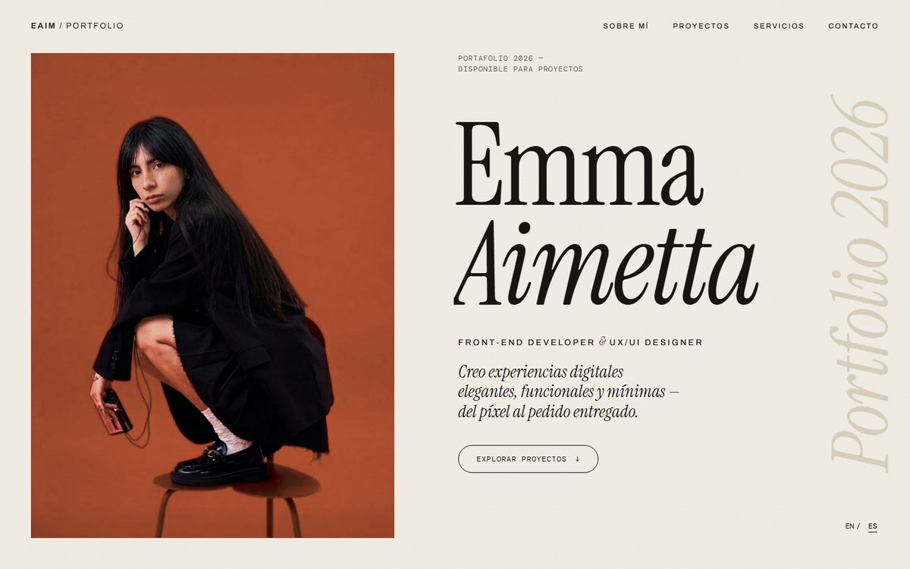
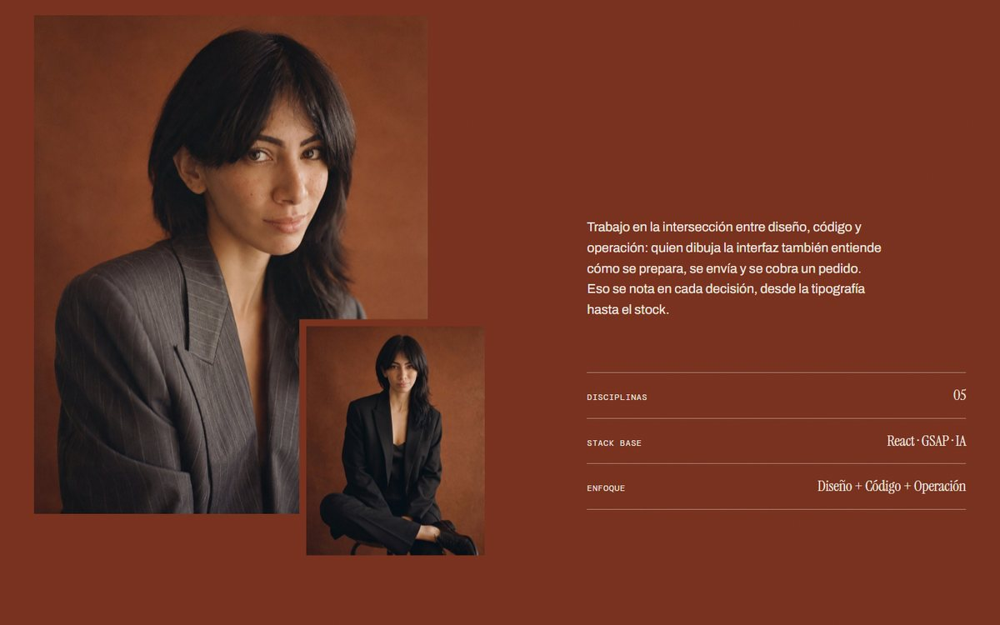
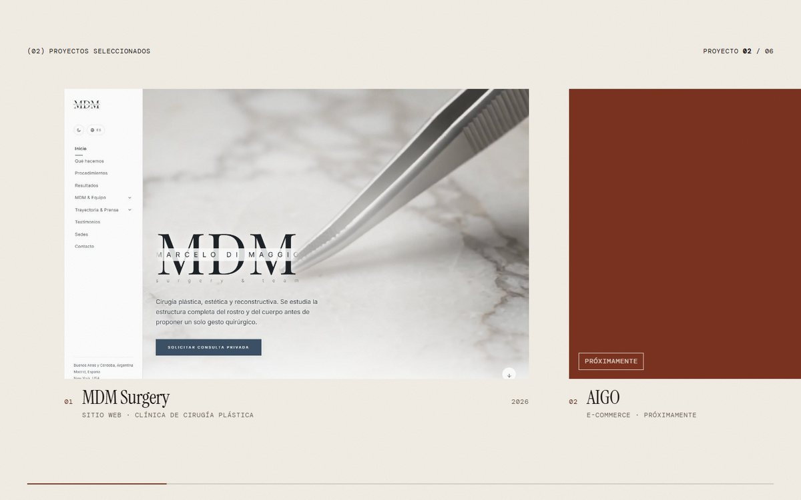
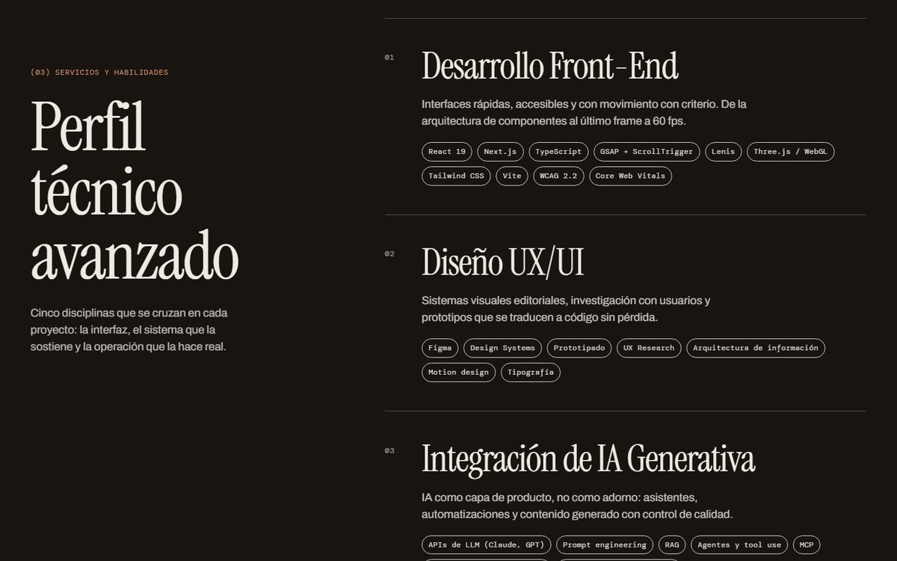
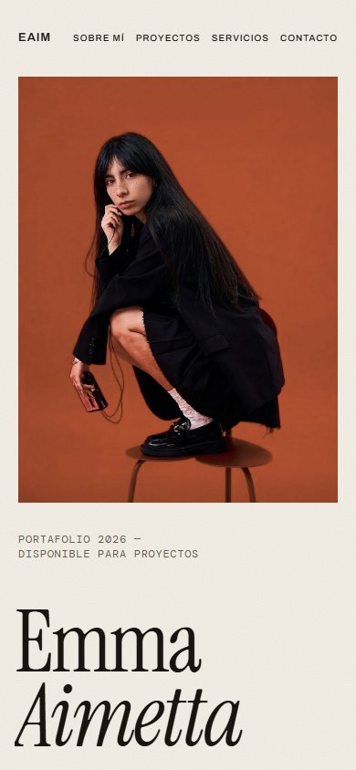

# Emma Aimetta — Portafolio

Portafolio personal interactivo de **Emma Aimetta** (Front-End Developer & UX/UI Designer): diseño editorial
en tonos arcilla y marfil, scroll suave, galería de proyectos con scroll horizontal y versión en español e inglés.

**Sitio en vivo:** https://portfolio-emma-aimetta.vercel.app



## Qué incluye

| Sección | Qué hace |
| --- | --- |
| **Loader** | Pantalla de carga "retrato que se revela": contador 000 → 100 y la foto aparece de abajo hacia arriba; al terminar, el marco vuela hasta el lugar exacto de la foto del inicio. Solo sale en la primera visita de la sesión. |
| **Inicio** | Foto completa (sin recortes), nombre en serif con cursiva, palabra "Portfolio 2026" vertical en el margen, botón magnético. |
| **Sobre mí** | Frase que se enciende palabra a palabra con el scroll, collage de dos fotos con parallax y datos clave. |
| **Proyectos** | Galería con scroll horizontal "pinned": el scroll vertical avanza el carril, con contador y barra de progreso. Los proyectos pendientes aparecen como "Próximamente". En móvil las tarjetas se apilan. |
| **Servicios** | Cinco disciplinas (Front-End, UX/UI, IA generativa, E-commerce, Logística) con sus tecnologías, más un marquee de herramientas complementarias. |
| **Contacto** | Email, LinkedIn, GitHub e Instagram con el retrato a sangre en la esquina. |
| **Cursor propio** | Punto y anillo que crecen sobre enlaces y muestran "Ver" / "Pronto" sobre los proyectos; cambia de color según la sección. Solo con ratón o trackpad. |
| **ES / EN** | Selector de idioma; la elección se recuerda. |

<p>
  
  
</p>
<p>
  
  
</p>

Versión móvil, con las tarjetas de proyectos apiladas:



## Tecnología

- **React 19** y **Vite**
- **GSAP** (ScrollTrigger, SplitText) para el scroll horizontal, los revelados de texto y las micro-interacciones
- **Lenis** para el scroll suave, conducido por el ticker de GSAP (un único bucle de animación)
- CSS puro con variables (sin framework de estilos); animaciones solo con `transform` y `opacity` para mantener 60 fps
- Accesibilidad: enlace para saltar al contenido, foco visible, navegación por teclado, respeto de `prefers-reduced-motion`

## Empezar

```bash
npm install
npm run dev      # servidor de desarrollo
npm run build    # genera /dist
npm run preview  # sirve /dist
```

Añade `?loader` a la URL para ver siempre la pantalla de carga.

## Dónde editar

| Qué | Dónde |
| --- | --- |
| Textos (ES / EN), proyectos, email y redes | `src/data/content.js` |
| Colores y tipografías | `src/styles/tokens.css` |
| Foto del inicio | `public/img/home-emma.jpg` |
| Fotos de proyectos | `public/img/projects/` y el campo `cover` en `content.js` |

Los proyectos con `soon: true` aparecen como "Próximamente". Para publicar uno: `soon: false`,
`cover: './img/projects/xx.jpg'` (con su `ratio` = ancho / alto) y `url: 'https://…'`.

## Imágenes

`img/` guarda las fotos originales. `python scripts/process-images.py` (requiere `pillow` y `numpy`) genera las
versiones optimizadas de `public/img/`: recorta los marcos de película, retoca el fondo y la firma de la foto
del inicio y ajusta los tamaños.

## Estructura

```
├─ index.html                  contenedor #scroller y decisión de mostrar el loader
├─ public/img/                 imágenes servidas (inicio, sobre mí, contacto, proyectos)
├─ img/                        fotos originales
├─ docs/screenshots/           capturas de este README
├─ scripts/process-images.py   procesado de imágenes
└─ src/
   ├─ App.jsx  main.jsx
   ├─ components/              Header, Hero, About, Projects, Skills, Contact, Loader, Cursor, SmoothScroll…
   ├─ hooks/                   useSection (temas y revelados), useMagnetic
   ├─ lib/                     gsap.js, reveal.js, i18n.jsx, loader.js
   ├─ data/content.js          todo el contenido editable
   └─ styles/                  tokens.css, base.css, scroll.css
```

## Despliegue

Cada `git push` a `main` se despliega automáticamente en Vercel (preset Vite, sin configuración extra).
