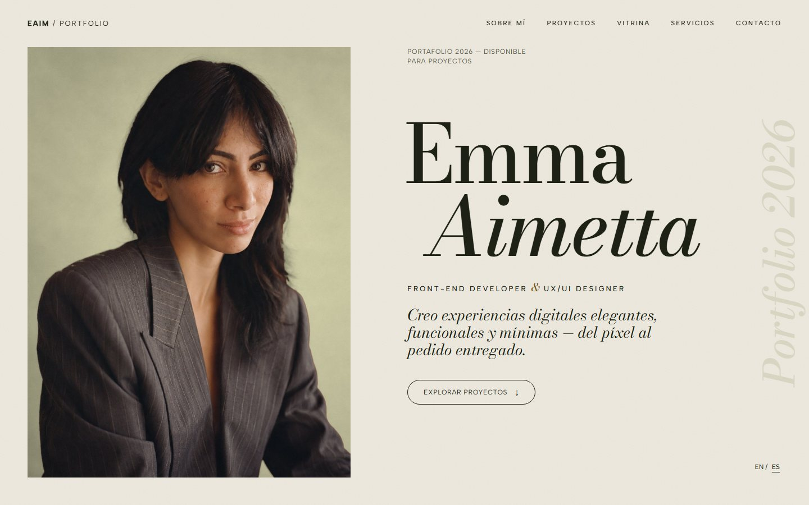
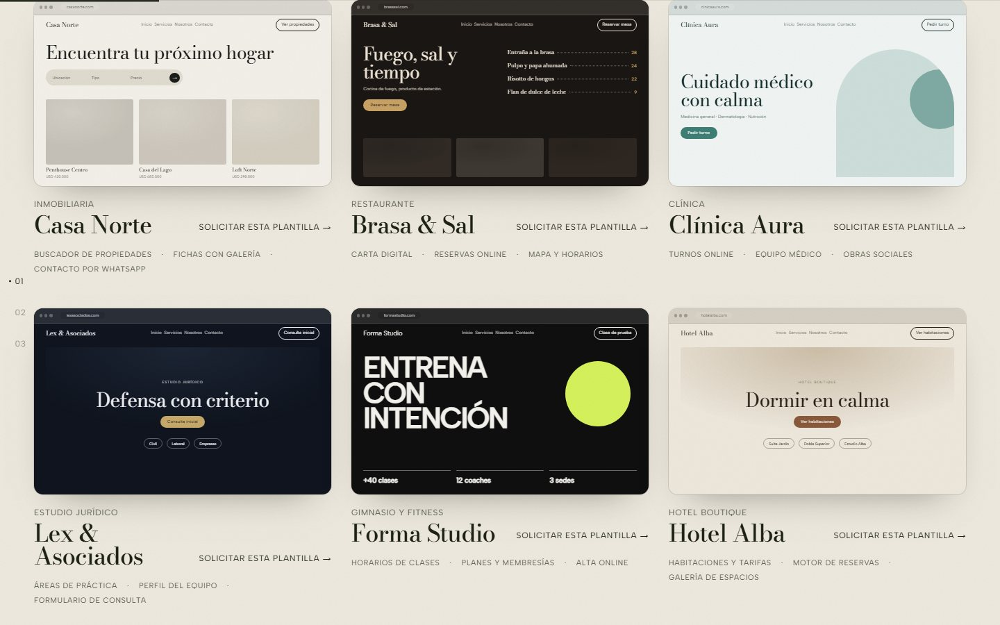
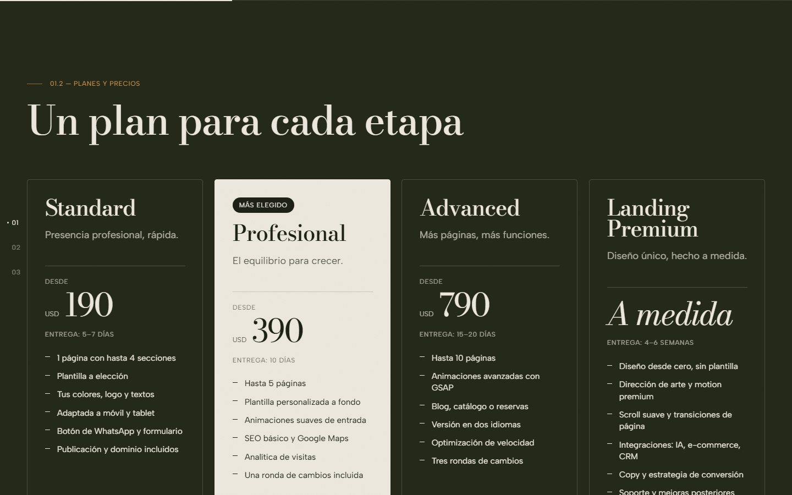
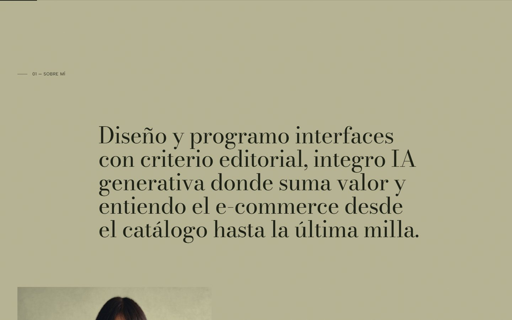
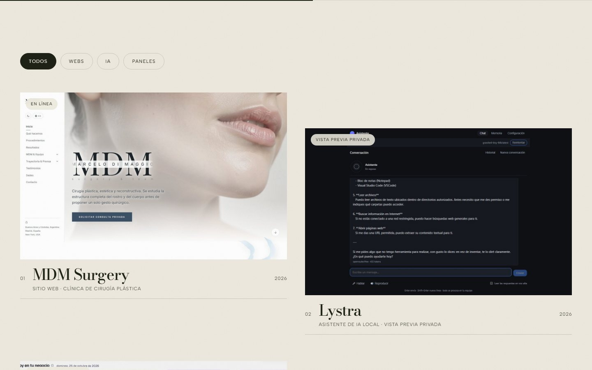
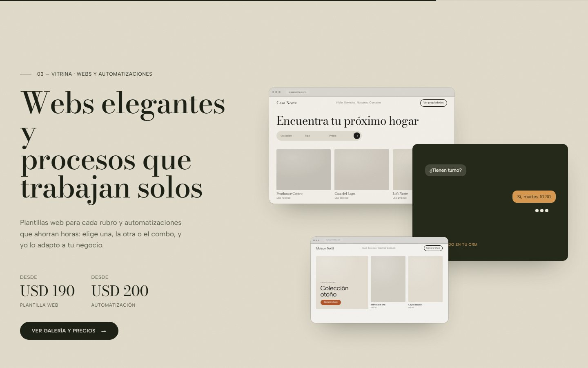
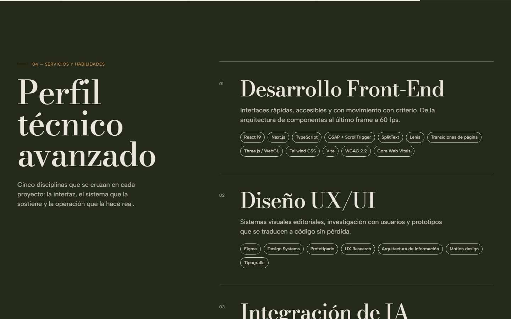
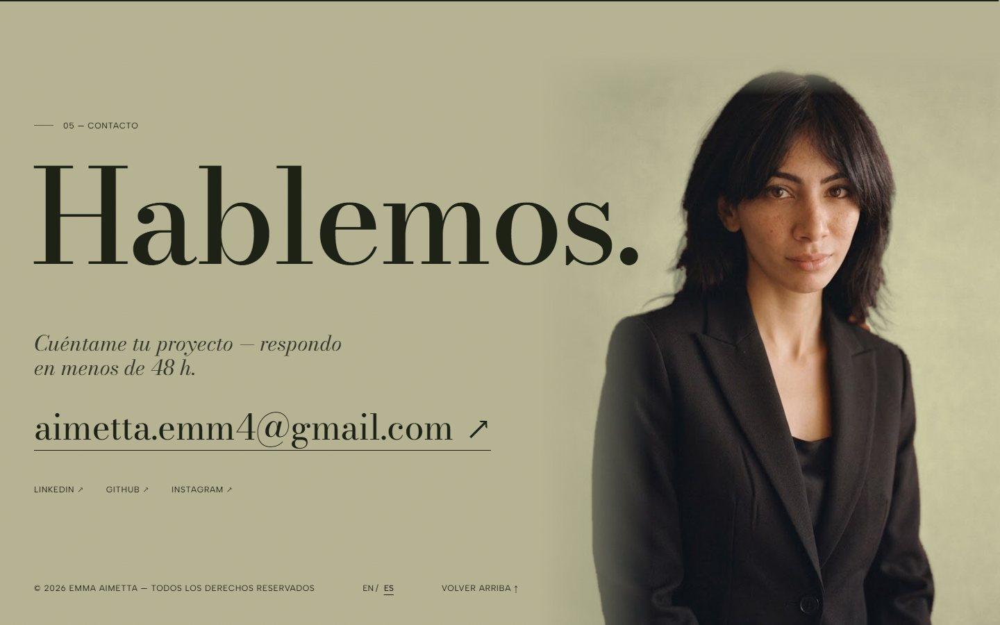
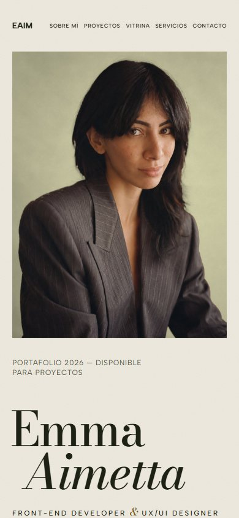

# Emma Aimetta — Portafolio

Portafolio personal interactivo de **Emma Aimetta** (Front-End Developer & UX/UI Designer): diseño editorial,
minimalista y premium en tonos lino, oliva y ámbar, con scroll suave, galería de proyectos con scroll
horizontal, versión en español e inglés, una **página con todos los proyectos** y una **vitrina de webs y automatizaciones con planes y precios**.

**Sitio en vivo:** https://portfolioeaim.vercel.app



## Qué incluye

| Sección | Qué hace |
| --- | --- |
| **Loader** | Pantalla de carga "retrato que se revela": contador 000 → 100 y la foto aparece de abajo hacia arriba; al terminar, el marco vuela hasta el lugar exacto de la foto del inicio. Solo sale en la primera visita de la sesión. |
| **Inicio** | Retrato completo, nombre en serif de alto contraste (Bodoni Moda) con revelado letra a letra, palabra "Portfolio 2026" vertical, botón magnético. |
| **Sobre mí** | Frase que se enciende palabra a palabra con el scroll y un retrato que se revela con una ventana animada (clip-path) y parallax. |
| **Proyectos** | Galería con scroll horizontal "pinned": las tarjetas se inclinan según la velocidad del scroll, con contador y barra de progreso. Los privados (AIGO, Agency OS, Lystra) solo muestran una vista previa, sin enlace; MDM Surgery es el único que se abre. Botón "Ver todos los proyectos". En móvil se apilan. |
| **Vitrina (franja)** | Franja de la portada que muestra plantillas web y una automatización animada, con precios "desde", y lleva a la vitrina. |
| **Servicios** | Cinco disciplinas con sus tecnologías y un marquee que acelera (e invierte el sentido) con el scroll. |
| **Contacto** | Email, LinkedIn, GitHub e Instagram, con el retrato a sangre en la esquina. |
| **Cursor propio** | Punto y anillo que crecen sobre enlaces y muestran "Ver" / "Pronto" / "Pedir"; cambia de color según la sección. Solo con ratón o trackpad. |
| **ES / EN** | Selector de idioma; la elección se recuerda. |

### Todos los proyectos (`/#/proyectos`)

Página con transición de cortina: cinta animada con los nombres, **AIGO** destacado a todo el ancho (proyecto propio, hecho con un amigo; vista previa privada), filtros (Todos / Webs / IA / Paneles) y cuadrícula con entrada escalonada e inclinación al pasar el cursor.

### Vitrina (`/#/vitrina`)

Una segunda página dentro del mismo sitio, con transición de cortina, que ofrece **dos servicios** y su combo:

- **Portada con dos puertas** (Webs / Automatizaciones) sobre un fondo animado de constelación que reacciona al cursor; la puerta con el cursor se abre. Un índice lateral fijo (01 / 02 / 03) marca en qué capítulo estás.
- **01 · Webs:** galería de 9 plantillas por rubro (miniaturas dibujadas con código que "scrollean" al pasar el cursor, filtro animado) y 4 planes con precios que cuentan hasta su valor.
- **02 · Automatizaciones:** catálogo de 6 flujos con mini interfaces animadas y su precio inicial, 4 planes por tamaño (pequeña, normal, compleja, pack de 3 a 5) y **paquetes por rubro** (Restaurante, Tienda online, Servicios) con mantenimiento opcional.
- **03 · Combo Web + Automatización:** dos paquetes con su rango de precio.
- **Proceso** en cuatro pasos y un cierre con canales de contacto. Las solicitudes abren un correo con el plan o la plantilla elegidos.

<p>
  
  
</p>
<p>
  
  
</p>
<p>
  
  
</p>
<p>
  
</p>

Versión móvil:



## Tecnología

- **React 19** y **Vite**
- **GSAP** (ScrollTrigger, SplitText) para el scroll horizontal, los revelados de texto e imagen, el filtro animado y las micro-interacciones
- **Lenis** para el scroll suave, conducido por el ticker de GSAP (un único bucle de animación); su velocidad alimenta el marquee y la inclinación de las tarjetas
- CSS puro con variables (sin framework de estilos); animaciones solo con `transform`, `opacity` y `clip-path` para mantener 60 fps
- Accesibilidad: enlace para saltar al contenido, foco visible, navegación por teclado, respeto de `prefers-reduced-motion`

## Empezar

```bash
npm install
npm run dev      # servidor de desarrollo
npm run build    # genera /dist
npm run preview  # sirve /dist
```

Añade `?loader` a la URL para ver siempre la pantalla de carga.

## Dónde editar

| Qué | Dónde |
| --- | --- |
| Textos (ES / EN), proyectos, email y redes | `src/data/content.js` |
| Plantillas web, planes y **precios** | `src/data/templates.js` |
| Automatizaciones, planes, combos y **precios** | `src/data/automations.js` |
| Colores y tipografías | `src/styles/tokens.css` |
| Fotos de la página | `public/img/` y las rutas en `site` de `content.js` |
| Fotos de proyectos | `public/img/projects/` y el campo `cover` en `content.js` |

Los precios de `templates.js` y `automations.js` son de ejemplo (USD): cámbialos por los tuyos. Los proyectos con `soon: true`
aparecen como "Próximamente"; para publicar uno: `soon: false`, `cover: './img/projects/xx.jpg'` (con su
`ratio` = ancho / alto) y `url: 'https://…'`.

## Imágenes

`img/` guarda las fotos originales. `python scripts/process-images.py` (requiere `pillow` y `numpy`) genera las
versiones optimizadas de `public/img/`: recorta los marcos de película y recolorea el fondo terracota a **oliva**
(el tono de los bloques de la página) sin tocar piel, pelo ni ropa. Si cambias `--stone` en `tokens.css`, cambia
también `STONE` en el script.

## Estructura

```
├─ index.html                  contenedor #scroller y decisión de mostrar el loader
├─ public/img/                 imágenes servidas (inicio, sobre mí, contacto, proyectos)
├─ img/                        fotos originales
├─ docs/screenshots/           capturas de este README
├─ scripts/process-images.py   procesado y recoloreo de imágenes
└─ src/
   ├─ App.jsx  main.jsx        páginas (inicio / vitrina / proyectos), transición de cortina, progreso de lectura
   ├─ components/              Header, Hero, About, Projects, TemplatesTeaser, Skills, Contact,
   │                           TemplatesPage, ProjectsPage, TemplateMock, Loader, Cursor, SmoothScroll…
   ├─ hooks/                   useSection (temas y revelados), useMagnetic, useTilt, useMarquee
   ├─ lib/                     gsap.js, reveal.js, i18n.jsx, loader.js, nav.jsx
   ├─ data/                    content.js, templates.js
   └─ styles/                  tokens.css, base.css, scroll.css
```

## Despliegue

Cada `git push` a `main` se despliega automáticamente en Vercel (preset Vite, sin configuración extra).
La navegación entre páginas usa el hash (`/#/vitrina`), así que funciona en cualquier hosting estático.
